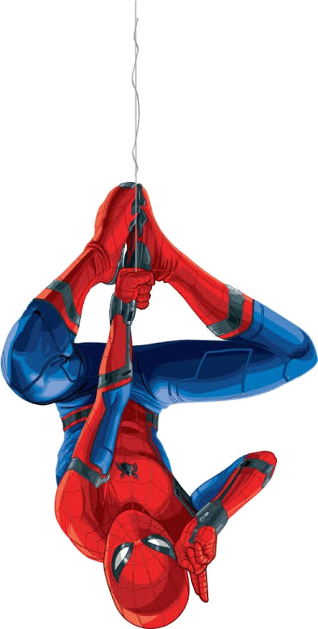

# 🕷️ Spider-Man Hanging Desktop Widget

A lightweight, interactive desktop companion widget built with Electron. Spider-Man hangs upside down by a web strand from the top of your screen, swinging with natural pendulum physics, delivering comic dialogue quips, and dropping down every 2 minutes!



## ✨ Features

- **Top-Edge Anchor**: Snaps to the top center bezel of your primary monitor.
- **Dynamic Click-Through**: Transparent regions allow full mouse pass-through so your background windows, browser tabs, and desktop are never blocked.
- **Multiple Figures Included**:
  - MCU Spider-Man (Tom Holland)
  - The Amazing Spider-Man (Andrew Garfield)
  - Symbiote / Black Suit Spider-Man (Bully Maguire)
- **Automatic Web Drop**: Every 2 minutes, Spidey lowers down on an extending web line with realistic elastic bounce physics, chats, and reels back up!
- **Interactive Comic Dialogues**: 75+ authentic quotes and character quips when clicked or during idle time.
- **Repositionable**: Click and drag to position him anywhere along your screen.
- **One-Click Silent Launch**: Run via desktop shortcut without opening any terminals or editors.

## 🚀 Getting Started

### Prerequisites
- [Node.js](https://nodejs.org/) (v16 or higher)

### Installation
```bash
git clone <your-repo-url>
cd spidey-hanging-widget
npm install
```

### Running Locally
```bash
npm start
```

## 🎮 Controls & Shortcuts

| Action | Control |
|---|---|
| **Chat / Speak** | Click on Spider-Man |
| **Drop / Reel Web** | Press `Spacebar` or `D` key |
| **Next / Previous Figure** | Hover to use `◀` / `▶` buttons, or scroll mouse wheel over Spidey |
| **Switch Figure Directly** | Press number keys (`1`, `2`, `3`) |
| **Fast Switch** | Double-click Spider-Man |
| **Reposition** | Click & drag Spider-Man |
| **Close** | Hover to reveal the `✕` button on the top-right |

## 🎨 Adding Your Own Custom Figures
Drop any transparent `.png` image into the `assets/` folder. The widget automatically discovers new figures and includes them in the carousel!

## 📜 License
MIT
